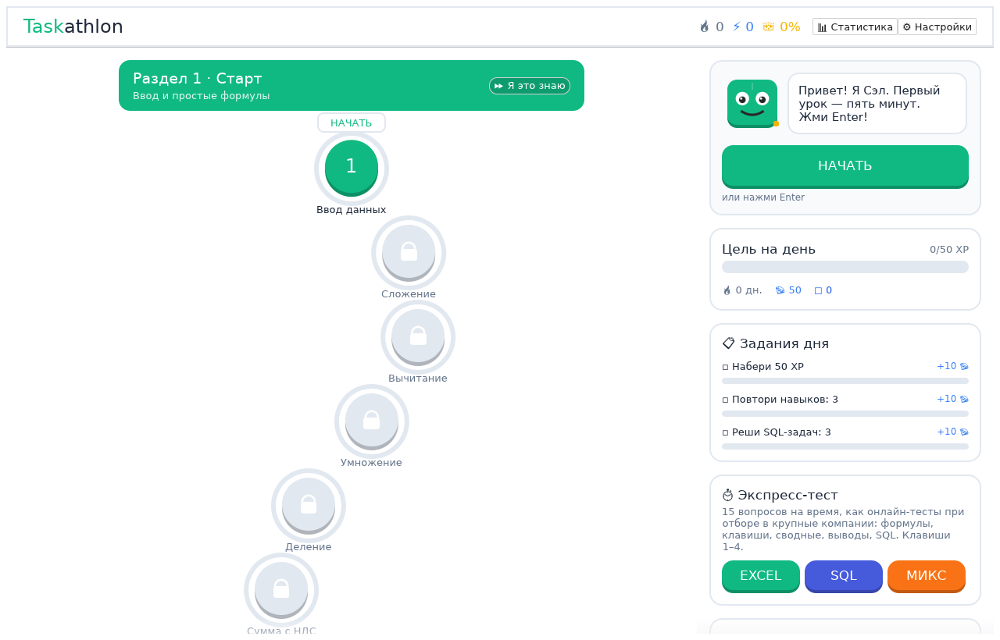
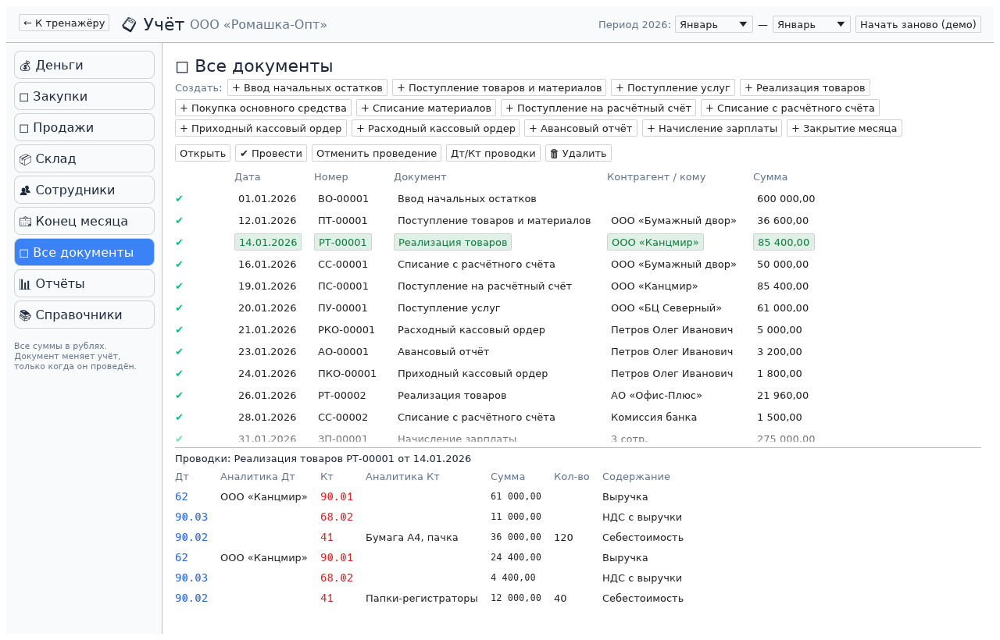
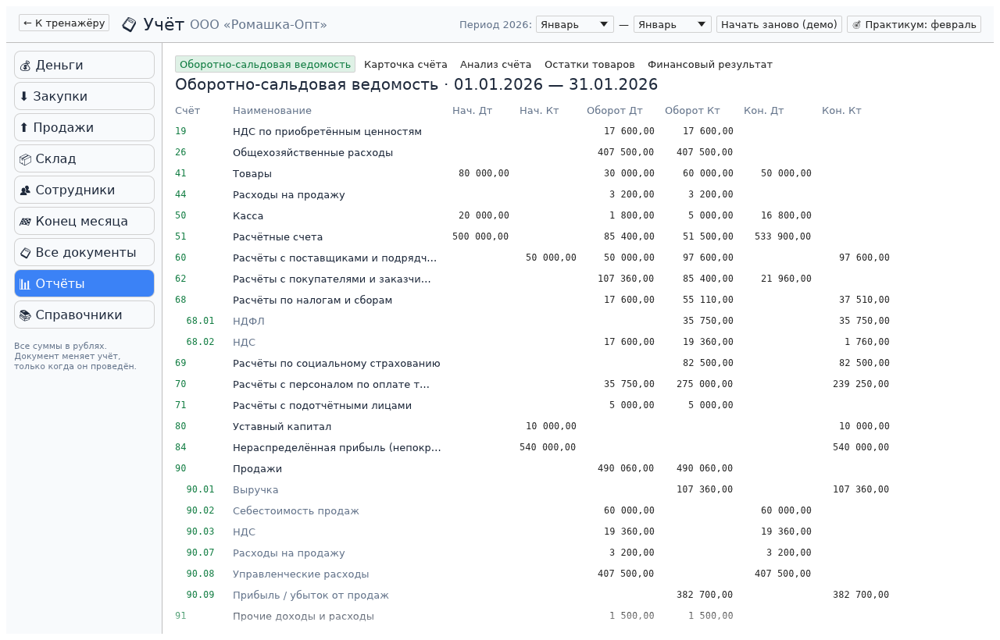
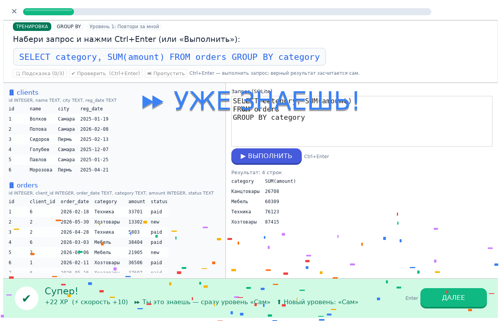
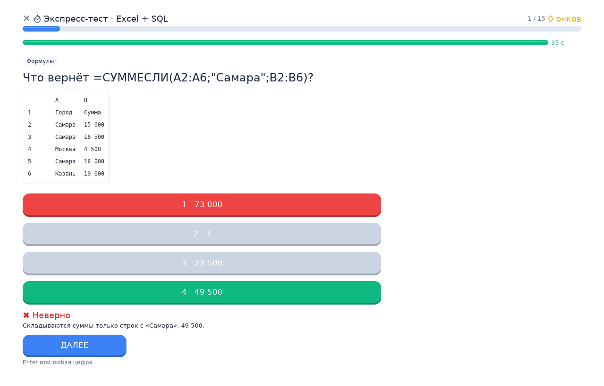

<h1 align="center">Taskathlon</h1>

<p align="center">
  <b>A speed and job-interview trainer for Excel, SQL and accounting.</b><br>
  Short lessons, real work cases, timed tests, sprints for personal records and a full accounting program to practise in.<br>
  The spreadsheet inside is a real spreadsheet engine, not a picture of one.
</p>

<p align="center">
  
  
  
</p>

<p align="center">
  
</p>

## Why

For people applying for accountant, office analyst or finance roles who want Excel and SQL to become muscle memory, and who need to prepare for an online screening test in a day. The interface is currently in Russian; an English interface is in progress.

## What's inside

- 🧮 **Excel.** References and `$`, SUMIF(S), VLOOKUP/XLOOKUP/INDEX+MATCH, dates, text, pivots and shortcuts, with Russian function names as in Russian Excel (`=СУММЕСЛИ(A2:A9;"Самара";B2:B9)`). Formulas are computed by the GridCraft engine.
- 🗄 **SQL.** 16 skills from `SELECT` to window functions. Write a query and see the result. Answers are re-checked on different data, so you can't hard-code them.
- 📒 **Accounting program.** A working double-entry ledger: catalogs, 13 document types with **Post / Unpost**, entries, month-end close, trial balance, account card, account analysis and P&L, plus a timed workshop of 11 tasks.
- 💼 **Work cases and interview mode:** a brief from a manager, data, a timer and a debrief.
- ⏱ **Timed test:** 15 questions, each with its own timer. Excel, SQL or mixed.
- 🏁 **Sprint:** 10 real tasks against the stopwatch, with medals and personal records.
- ⚡ **Motivation:** faster answers earn more points. Combos, streaks, a daily goal, daily quests, gems, streak freezes, streak wagers and 18 achievements.
- 🧠 **Adaptivity:** what you already know goes faster ("I know this" test-outs and level jumps). Mistakes come back, and reviews are scheduled with FSRS.
- 🔔 **Desktop reminder** through a systemd user timer. Everything works offline.

<p align="center">
  
  
</p>
<p align="center">
  
  
</p>

## Run

You need Rust 1.95+ ([rustup](https://rustup.rs)).

```sh
cargo run --release -p gridcraft-learn --bin taskathlon
```

Press **Enter** to start a lesson. Progress is saved to `~/.local/share/gridcraft-learn/`.

## Layout

| Path | What |
|---|---|
| `crates/learn` | Learning runtime: content generators, grading, staircase, FSRS, quests, SQL grading |
| `crates/ledger` | Accounting core: chart of accounts, catalogs, documents, posting, month close, reports, practice tasks |
| `apps/gridcraft-learn` | The desktop app (binary `taskathlon`) |
| everything else | GridCraft, the spreadsheet engine and UI it is built on |

## Built on GridCraft

Taskathlon is built on **[GridCraft](https://github.com/storytold/gridcraft)**, an open-source spreadsheet written in Rust by the ArtCraft team (MIT OR Apache-2.0). The formula engine, the grid and the cell UI come from there, and the original spreadsheet still builds with `cargo run -p gridcraft`.

Taskathlon is not made, sponsored or endorsed by the ArtCraft team. The changes made to GridCraft are listed in [NOTICE](NOTICE).

## Legal

- License: MIT or Apache-2.0, at your option ([LICENSE-MIT](LICENSE-MIT), [LICENSE-APACHE](LICENSE-APACHE)).
- All content, the mascot, sounds and colours are original. No third-party vendor assets are used ([ATTRIBUTION.md](ATTRIBUTION.md)).
- The accounting module is a clean-room implementation of public accounting rules (the Russian chart of accounts, PBU/FSBU and the Tax Code). It contains no code, forms, icons or templates from any commercial accounting product.
- "Excel" is a trademark of Microsoft and "1C" is a trademark of 1C Company. Taskathlon is not affiliated with either.

## Docs

[Architecture](docs/learn/ARCHITECTURE.md) · [Adaptive model](docs/learn/ADAPTIVE_MODEL.md) · [Accounting module](docs/ledger/PLAN.md) · [Known limitations](docs/learn/KNOWN_LIMITATIONS.md) · [Progress](docs/learn/PROGRESS.md)
