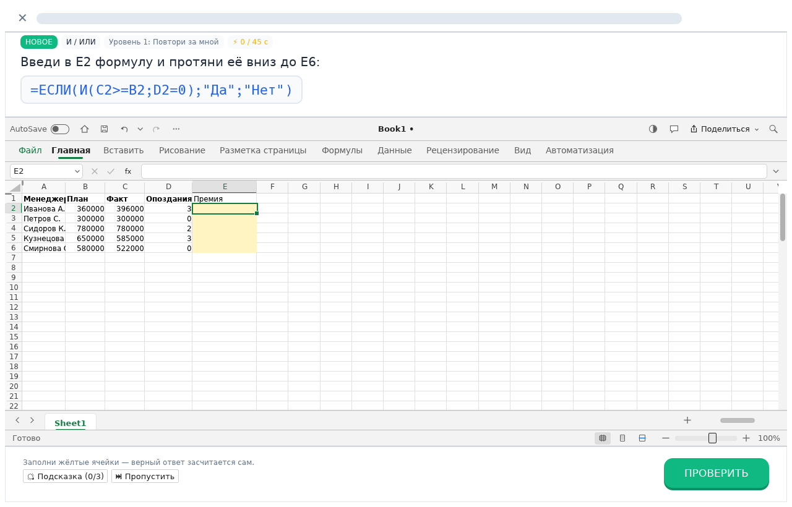
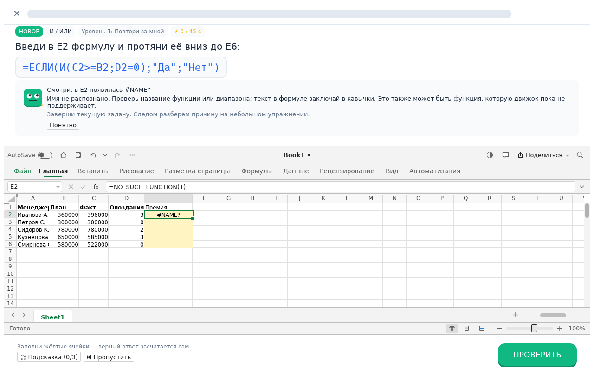

# Урок: меньше решений вокруг каждого действия

Разбор от 12 октября 2026 года. Основание: 18 скриншотов пользовательской сессии Duolingo, текущие `screens.rs`, `view.rs` и снимки Taskathlon в `docs/images`. Это наблюдения по статичным экранам, а не измерение удержания пользователей или скорости обучения. Анимации, задержки и звук по ним оценить нельзя.

## Главное различие

На скриншотах Duolingo вопрос, ответ и продолжение образуют устойчивый ритм: прочитал → сделал одно действие → получил короткий результат → продолжил. Главная кнопка остаётся в нижнем правом углу. В Taskathlon учебная задача живёт внутри полноценного редактора: ученик одновременно видит условие, образец, несколько статусов, клавиши, секундомер, подсказки и инструменты таблицы. Полноценная таблица нужна для переноса навыка на работу, но её окружение требует более строгой иерархии.

| Наблюдение в Duolingo | Состояние Taskathlon | Приоритет |
| --- | --- | --- |
| `Check` и `Continue` занимают одно место; вспомогательные действия заметно слабее | `Проверить` было маленькой кнопкой над таблицей, `Далее` — крупной внизу | Исправлено в этой итерации |
| Вопрос и область ответа отделены большим количеством свободного пространства | Верхняя карточка собирает все статусы и действия; длинные названия и сочетания клавиш конкурируют за одну строку | Перенос действий вниз и перенос статусов на следующую строку сделаны; следующий шаг — сократить постоянно видимые статусы |
| Новое слово, сложное упражнение и прошлая ошибка обозначены одним понятным маркером | Есть `НОВОЕ`, `РАБОТА НАД ОШИБКОЙ` и уровни, но одновременно показываются несколько меток | Оставлять один учебный контекст главным, уровень и клавиши — второстепенными |
| Персонаж отдельно сообщает «разберём пропущенное упражнение» перед возвратом к ошибке | Повторение и очередь исправлений уже существуют; контекст перехода выражен преимущественно метками | Добавить короткое объяснение причин смены задания, без дополнительного обязательного клика на каждой ошибке |
| Ошибка с артиклем получает красный результат и правильный ответ; опечатка `frish` принята с сообщением `You have a typo` | Проверки формулы и значения дают правильность и пояснение; этого недостаточно для различения непонимания и технической ошибки ввода | Различать тип причины и объяснять конкретное исправление; не принимать произвольные «похожие» формулы |
| Итог урока сначала показывает XP и точность, затем выполненные квесты, затем награду | Экран завершения одновременно показывает XP, точность, кристаллы, комбо, уровни, серию и цель | Начать с результата обучения и двух метрик; прочие награды показывать последовательно либо раскрывать по желанию |
| После завершения предлагается повторить уровень с наградой; есть `Maybe later` | Есть отдельные режимы повторения, спринта, теста и кнопка «Ещё урок» | Предлагать один уместный следующий шаг и возможность закончить; не выводить все режимы как равные варианты |
| Домашний экран выделяет один текущий узел, дополнительные режимы отделены навигацией | Главная содержит много карточек режимов в одной боковой колонке | После урока упростить главный экран: продолжение + цель, остальные режимы в отдельный раздел |

## Что изменено сейчас

- Проверка, пропуск и подсказки перенесены из карточки условия в фиксированную нижнюю панель. Проверка стала крупной основной кнопкой в том же углу, где появляется «Далее».
- Для пояснения в панели результата зарезервирована ширина, чтобы длинный текст не вытеснял кнопки продолжения и исправления.
- Статусы задания переносятся на следующую строку, а не продолжают расширять одну строку.

Выбор метода сохраняет собственные кнопки 1–4; до выбора инструмента панель проверки и таблица не показываются. Автоматическая проверка и горячие клавиши продолжают работать по прежним правилам. Контекстное знакомство с ошибками таблицы и сохранение масштаба реализуются отдельными изменениями этой итерации.

## Следующая итерация

1. **Снизить нагрузку над таблицей.** В обычной тренировке сделать постоянными только условие и текущий шаг. Секундомер оставить для спринта; клавиши и пример показывать по учебному контексту. Проверить, сколько строк таблицы остаётся при увеличенном масштабе и нескольких подсказках.
2. **Дать точный разбор ошибки.** Показывать ячейку, наблюдаемый результат и одну причину, которую действительно подтверждает проверка. Ошибка `#NAME?`, неверный знак сравнения и корректный результат, полученный неподходящим методом, требуют разных объяснений и следующих упражнений.
3. **Делать переход к повторению понятным.** Короткая реплика персонажа должна связывать увиденную ошибку со следующим заданием; цель — распознать причину, исправить её, решить близкий пример, позже повторить на новых данных.
4. **Упростить завершение.** Назвать приобретённый навык, показать XP и точность; остальные события раскрывать после этого. Возможность остановиться должна оставаться доступной. Последовательность наград — вариант для проверки, не доказанная необходимость копировать все промежуточные экраны Duolingo.

## Ручная проверка перед выпуском

Проверить обычную формульную задачу, SQL, выбор метода, срез и ошибку с длинным пояснением. Для каждого пройти состояния «до ответа», «неверно», «исправление», «верно» и «следующее задание». Повторить при небольшом окне и персональном масштабе. Основное действие должно оставаться видимым, таблица — иметь пригодную рабочую область, а пояснение — читаться без наложения на кнопки. Компиляция проверяет типы и заимствования, но не заменяет эту проверку интерфейса.

## Проверено в этой итерации

44 теста учебного ядра и приложения прошли. Снимки реального интерфейса проверены при
1280×820 и 960×640: формула, сообщение о первой ошибке и неверный ответ. В малом окне
длинное сообщение оставляет мало строк таблицы; «Понятно» закрывает сообщение и возвращает место.
Исправлена обнаруженная на снимке проблема: сообщение персонажа больше не раскрывает
обычную подсказку и не вытесняет условие за верхнюю границу окна.

